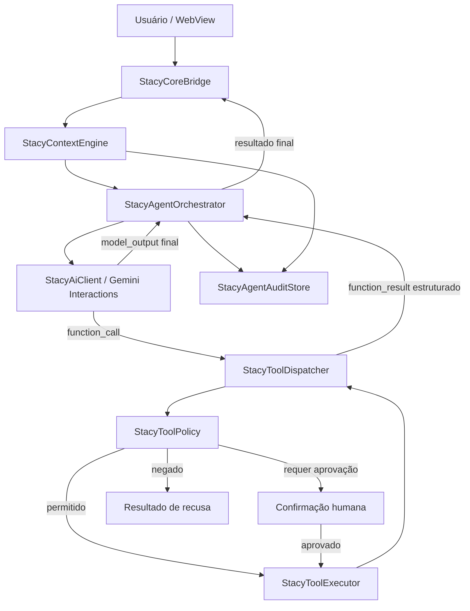

# STACY Agent Core 0.5.0 — decisões técnicas e plano de implementação

**Status:** especificação registrada para a próxima implementação. Não contém alterações de código.
**Branch de documentação:** `design/stacy-agent-core-0.5.0`
**Base:** `65e6acc91b18aeaab6fa8c513d726e789135513e` (branch de estabilização 0.4.5)
**Escopo:** evoluir o CORE Kotlin/Gemini para um agente com ferramentas, execução controlada e memória contextual, sem comprometer a estabilização da 0.4.5.

---

## 1. Evidências verificadas na base atual

Os pontos abaixo foram confirmados diretamente nos arquivos da branch `work/stacy-0.4.5-package-implementation`, e não apenas inferidos de descrições anteriores.

| Componente | Situação observada |
|---|---|
| `StacyAiClient.kt` | Faz POST para `https://generativelanguage.googleapis.com/v1/interactions`, usando `gemini-3.8-flash`. Envia texto, instrução de sistema, configuração de geração e, nas pesquisas, a ferramenta `google_search`. |
| Estado de ação | Quando a resposta tem status `requires_action`, a implementação atual retorna erro informando que a ação adicional ainda não é executada. |
| Parsing de resposta | `extractText()` prioriza `output_text` e extrai texto de etapas; ainda não há despachante de `function_call` / envio de `function_result`. |
| Continuidade | `previous_interaction_id` é armazenado por conversa no SQLite e enviado nas chamadas seguintes. |
| `StacyCoreBridge.kt` | Tenta primeiro o processamento local via `StacyNativeCore`; se não houver comando local, encaminha a mensagem ao cliente Gemini. Não há, nesta fronteira, um registro genérico e executor controlado de ferramentas Gemini. |
| `StacyLocalStore.kt` | Já contém tabelas `tasks`, `memories`, `conversations` e `conversation_messages`; também persiste o ID remoto de interação por conversa. |
| Memórias existentes | A tabela `memories` observada guarda `content` e `created_at`; isso é persistência básica, não recuperação semântica. |
| Histórico | Mensagens e estado pending/completed/failed/interrupted são persistidos. A consulta do histórico é limitada por quantidade; não foi encontrada nesta auditoria sumarização ou orçamento de tokens. |
| Limites operacionais | O transporte atual já possui fila limitada, deadline absoluto, cancelamento, retries controlados e métricas sanitizadas. A implementação do agente deve preservar essas proteções e coordená-las com os limites de ferramentas. |

**Conclusão verificada:** a deficiência central para a capacidade agêntica não é ausência de uma nova linguagem ou framework. É a ausência de um ciclo de orquestração de chamadas de função entre a resposta do Gemini e executores locais autorizados.

Arquivos de referência:
- `android/app/src/main/java/com/mrmorning/stacy/StacyAiClient.kt`
- `android/app/src/main/java/com/mrmorning/stacy/StacyCoreBridge.kt`
- `android/app/src/main/java/com/mrmorning/stacy/StacyLocalStore.kt`

## 2. Decisão arquitetural recomendada

**Manter Kotlin como CORE principal e Gemini Interactions como primeiro provedor.** Não migrar o núcleo para Python/FastAPI, nem adicionar LangChain, LangGraph ou MCP como dependências obrigatórias nesta primeira etapa.

Separar responsabilidades em componentes com contratos explícitos:

1. **StacyAiClient (transporte):** montar e enviar interações HTTP, interpretar status HTTP, gerir timeout/retry/cancelamento e devolver uma representação estruturada da interação. Não executar ferramentas.
2. **StacyToolRegistry:** registrar ferramentas permitidas, descrições, esquemas de argumentos, nível de risco, permissões e disponibilidade.
3. **StacyToolDispatcher:** validar nome, argumentos e política antes de encaminhar uma chamada ao executor específico.
4. **StacyToolExecutor:** executar uma ferramenta concreta em Kotlin, com timeout próprio, resultado estruturado e erros normalizados.
5. **StacyToolPolicy:** autorizar, negar ou exigir confirmação humana. A decisão de segurança deve ser determinística no aplicativo, nunca delegada ao modelo.
6. **StacyAgentOrchestrator:** coordenar a sequência modelo → chamadas de ferramenta → resultados → nova interação → resposta final, respeitando deadline e limites.
7. **StacyAgentAuditStore:** registrar execuções, chamadas, resultados resumidos, aprovações e estados para diagnóstico e recuperação.
8. **StacyContextEngine:** selecionar histórico recente, resumo e fatos relevantes por conversa, respeitando orçamento de contexto e privacidade.

O `StacyCoreBridge` permanece como fronteira entre interface/nativo e orquestração. Evitar colocar lógica de agente diretamente na Activity ou no JavaScript da WebView.

### Diagrama lógico

## 3. Fluxo correto do Gemini Interactions Tool Calling

A documentação atual do Google descreve o padrão com etapas `function_call` em `interaction.steps`, execução local e interação de acompanhamento contendo `function_result`, o `call_id` correspondente e `previous_interaction_id` apontando para a interação anterior.

Referências oficiais:
- Interactions API: https://ai.google.dev/gemini-api/docs/interactions-overview
- Guia de chamadas de função: https://docs.cloud.google.com/gemini-enterprise-agent-platform/models/capabilities/interactions/developer-guide
- Seção de continuidade por `previous_interaction_id`: https://docs.cloud.google.com/gemini-enterprise-agent-platform/models/capabilities/interactions/developer-guide

Requisitos para a implementação STACY:

- Enviar `tools` e `system_instruction` em cada nova interação na qual devam valer. Esses parâmetros são escopo da interação, não são herdados automaticamente apenas por usar `previous_interaction_id`.
- Percorrer todas as etapas devolvidas e detectar cada `function_call`; não depender apenas do campo de status `requires_action`.
- Preservar o identificador de chamada do modelo (na API REST, validar o campo de ID da etapa conforme o contrato vigente) e devolvê-lo em `call_id`.
- Enviar o resultado como etapa `function_result` e encadear com o ID da interação que originou a chamada.
- Continuar o loop até receber uma resposta final utilizável ou atingir um limite.
- Tratar múltiplas chamadas, chamadas desconhecidas, resultados inválidos, erros de ferramenta e interações incompletas sem perder o contexto.
- Confirmar os nomes e a forma exata dos campos REST usando exemplos REST oficiais e testes de contrato antes de implementar; os snippets do guia também usam SDKs e não substituem validação do payload REST usado pela STACY.

Não usar exemplos da API OpenAI Chat Completions como se fossem payloads Gemini. Não assumir que todo estado não concluído significa `requires_action`: inspecionar as etapas e o status efetivo.

## 4. Ciclo de agente: limites e comportamento

Pseudofluxo:

1. Receber solicitação e atribuir `requestId` / `executionId`.
2. Carregar contexto da conversa e memória relevante.
3. Enviar input, instrução e ferramentas habilitadas ao Gemini.
4. Interpretar todas as etapas da interação.
5. Se houver texto final, validar e concluir.
6. Se houver `function_call`, validar schema e política de cada chamada.
7. Pedir aprovação para ações que exigem consentimento.
8. Executar ferramentas autorizadas; operações mutáveis são sequenciais por padrão.
9. Produzir `function_result` para cada chamada, inclusive erro controlado.
10. Continuar com a interação anterior como contexto, reapresentando ferramentas e instrução.
11. Persistir estados e devolver resposta final à interface.

Guardrails iniciais a parametrizar e calibrar:
- Máximo inicial de 5 rodadas de modelo por solicitação.
- Máximo inicial de 8 chamadas de ferramenta por solicitação.
- Deadline total compartilhado entre rede, aprovação e execução; nenhum retry reinicia o prazo.
- Timeout por ferramenta menor que o deadline restante.
- Paralelismo somente para consultas comprovadamente independentes e sem efeitos colaterais.
- Operações de escrita, alteração ou exclusão executadas serialmente.
- Cancelamento deve propagar para requisição HTTP, ferramenta e estado persistido.
- Retentativas somente para falhas transitórias e em operações idempotentes.
- Chave de idempotência por operação para impedir duplicidade quando houver timeout ou repetição.

Os números são limites conservadores iniciais de projeto, não medições de desempenho. Devem ser ajustados após testes de latência e uso real.

## 5. Segurança e política de execução

Nenhuma chamada gerada pelo modelo pode virar execução arbitrária.

Política mínima:
- Allowlist de nomes de ferramentas; nunca usar reflexão para chamar métodos arbitrários.
- Validação rigorosa de JSON, tipos, campos obrigatórios, faixas e tamanho de strings.
- O dispatcher reconstrói argumentos tipados após validação; não confiar em argumentos brutos.
- Cada ferramenta declara categoria de risco e permissões Android necessárias.
- Consultas de leitura podem ser automáticas somente quando o usuário já concedeu a permissão aplicável.
- Alterações reversíveis devem ter consentimento configurável e apresentar resumo da operação.
- Exclusão, envio externo, publicação, compra, alteração sensível ou ação difícil de reverter exigem confirmação explícita.
- Negação ou ausência de permissão deve retornar resultado estruturado, sem fingir sucesso.
- Conteúdo vindo de páginas, documentos, e-mails ou resultados de ferramentas é dado não confiável, nunca instrução de sistema.
- Credenciais ficam no Android Keystore; nunca registrar chave API, tokens ou prompt privado completo.
- Registrar autor da solicitação, ferramenta, argumentos redigidos, política aplicada, aprovação e resultado.
- Resultados de ferramentas precisam ser limitados e sanitizados antes de retornar ao Gemini.

Para alarme exato, não assumir permissão concedida. A documentação Android exige verificar `canScheduleExactAlarms()` quando se usa `SCHEDULE_EXACT_ALARM`; a solicitação de acesso especial é responsabilidade do usuário. Preferir alarme inexato quando a precisão não for indispensável. Não adotar `USE_EXACT_ALARM` automaticamente: essa permissão tem casos de uso e política de distribuição mais restritos.

Referência oficial: https://developer.android.com/develop/background-work/services/alarms

## 6. Memória e contexto: evolução incremental

**Não adicionar banco vetorial no primeiro incremento.**

A base SQLite atual é suficiente para a primeira fase, desde que seja organizada e testada. Recomenda-se:

- Preservar `conversations` e `conversation_messages` como histórico-fonte.
- Adicionar tabela de resumos por conversa, com intervalo de mensagens coberto, versão do resumo e timestamp.
- Estruturar fatos de memória em registros com categoria, conteúdo, origem, confiança, data de criação/atualização e possibilidade de exclusão.
- Adicionar FTS5 para pesquisa textual local caso a consulta de memórias precise de busca textual mais eficiente.
- Não chamar FTS5 de busca vetorial: FTS5 é pesquisa textual. Embeddings exigem vetores e mecanismo de similaridade separado.
- Recuperar fatos por relevância e recência, nunca despejar toda a memória no prompt.
- Usar orçamento de tokens configurável; 8.000 tokens não deve ser tratado como limite universal.
- Criar resumo de conversa apenas quando o orçamento/contexto indicar necessidade, sem apagar o histórico bruto.
- Separar memória pessoal, resumo da conversa, estado de tarefa e trilha de execução.
- Permitir consultar, corrigir e apagar fatos memorizados.

Considerar embeddings e busca vetorial local/remota somente após testes demonstrarem que FTS5 + fatos estruturados + resumos não atendem a qualidade de recuperação pretendida.

## 7. Ferramentas iniciais e ordem de ativação

Começar com ferramentas de baixo risco e integradas ao armazenamento existente:

1. `tasks.list`, `tasks.create`, `tasks.complete`: tarefas locais. Escritas exigem política de consentimento e idempotência.
2. `memory.search`, `memory.save`, `memory.update`, `memory.delete`: memória local. Atualização e exclusão devem ser auditáveis.
3. `conversation.search` e `conversation.summary`: histórico e resumos.
4. `device.get_battery`: consulta somente leitura para validar Tool Calling ponta a ponta.
5. Pesquisa na Web: reutilizar integração Google Search existente e normalizar fontes.
6. Calendário, contatos, arquivos e alarmes: adicionar somente depois da camada de permissões e testes Android para cada caso.

Não começar com envio de mensagens, operações externas ou comandos gerais do dispositivo. Evitar uma ferramenta universal do tipo `execute_command`.

## 8. Testes obrigatórios e critérios de aceite

### Testes unitários
- Registro e descoberta de ferramentas.
- Schema válido/inválido e argumentos desconhecidos.
- Allowlist, política e autorização negada.
- Idempotência e chamadas duplicadas.
- Timeout e cancelamento.
- Normalização de erros.
- Máximo de rodadas e chamadas.
- Recuperação de execução interrompida.

### Testes de contrato Gemini
- Resposta somente textual.
- Uma chamada de função.
- Duas ou mais chamadas na mesma interação.
- Chamada desconhecida.
- Resultado de função contendo erro.
- Função que exige confirmação.
- Resposta intermediária sem texto final.
- Continuidade com `previous_interaction_id`.
- Ferramentas e instrução de sistema reapresentadas em cada interação necessária.
- Resposta expirada/inválida e recuperação sem duplicar operação.

### Testes instrumentados Android
- Consulta e escrita em SQLite.
- Permissões concedidas e negadas.
- Retorno de resultado à interface WebView.
- Rotação/recriação e encerramento do app durante execução.
- Cancelamento da solicitação.
- Integridade do histórico e auditoria após reinício.
- Alarmes e calendário em versões Android suportadas, caso esses módulos sejam ativados.

### Critérios de aceite
- Nenhuma função fora da allowlist executada.
- Nenhuma operação mutável executada sem a política aplicável.
- Uma ação executada no máximo uma vez por chave de idempotência.
- Toda chamada termina em sucesso, erro estruturado, cancelamento ou timeout — nunca fica pendente indefinidamente.
- A resposta final somente afirma ações confirmadas pelos resultados das ferramentas.
- Histórico e estado da execução mantêm isolamento por conversa.
- Não há regressão nos testes da 0.4.5.

## 9. Métricas

Instrumentar por solicitação e por ferramenta:
- tempo de fila;
- tempo de rede por interação;
- tempo de execução por ferramenta;
- tempo total do agente;
- rodadas do modelo;
- quantidade de chamadas de ferramentas;
- taxa de sucesso/erro por ferramenta;
- timeouts/cancelamentos;
- consumo de tokens, quando fornecido pela API;
- aprovação/negação de ações sensíveis.

Acompanhar P50 e P95. Não estabelecer promessa fixa de latência sem dados medidos, porque rede, modelo, ferramentas e permissões externas variam.

## 10. Sequência de implementação recomendada

**Fase 0 — proteger a versão estável**
- Concluir a publicação/validação da 0.4.5 em fluxo separado.
- Manter Agent Core na branch de evolução, sem alterações no pacote de release.

**Fase 1 — contratos e parsing**
- Criar DTOs Kotlin para interação, etapa, `function_call` e `function_result`.
- Separar transporte HTTP do parsing e da orquestração.
- Criar testes com JSONs reais/simulados da API Interactions.

**Fase 2 — primeira ferramenta segura**
- Criar Registry, Dispatcher, Policy e Executor.
- Implementar somente `device.get_battery` como ferramenta de leitura para validar o ciclo.
- Criar Agent Loop limitado e persistência de auditoria.

**Fase 3 — ferramentas locais**
- Conectar tarefas e memória via interfaces tipadas.
- Implementar consentimento, idempotência, timeout e cancelamento.
- Testar operações duplicadas e interrupções.

**Fase 4 — contexto e memória**
- Adicionar resumos e recuperação textual FTS5/fatos estruturados.
- Medir qualidade de recuperação e orçamento de tokens.
- Reavaliar embeddings apenas com evidência.

**Fase 5 — integrações Android**
- Calendário, contatos, arquivos e alarmes, com permissão específica e testes por versão Android.

**Fase 6 — extensibilidade**
- Avaliar cliente MCP somente quando houver pelo menos um servidor ou ecossistema de ferramentas concreto que justifique o protocolo.
- Considerar backend remoto apenas se houver requisito real de execução cross-device, disponibilidade contínua ou credenciais/integrações que não devam residir no dispositivo.

---

## 11. Estado da versão 0.4.5 e do ARS no momento do registro

Verificação feita em 2026-11-07:

- PR #53: aberta, em draft, base `main`, head `65e6acc91b18aeaab6fa8c513d726e789135513e`.
- Android CI no SHA final: sucesso; build, testes unitários, pacote instrumentado e testes instrumentados em emulador concluídos.
- Core CI: sucesso.
- MP-10 CI: sucesso.
- MP-11 CI: sucesso.
- Artefatos da execução Android: `STACY-final-debug-apk` e relatórios instrumentados. O APK é artefato **debug**, não substitui o release assinado do ARS.
- Etapa `Publish signed STACY update channel`: ignorada, pois o evento foi PR e não push em `main`.
- Manifesto ARS consultado: ainda em `versionName=0.4.4`, `versionCode=34`, package `com.mrmorning.stacy`.
- Portanto, a 0.4.5 **ainda não estava publicada no ARS** no momento da consulta.
- Publicação release depende de merge/push para `main), CI verde no evento de push, secrets configurados, assinatura validada pelo certificado fixado no script, APK release publicado e manifesto remoto atualizado.
- Validação física em aparelho real continua pendente; teste de emulador não substitui essa etapa.

Links de evidência:
- PR #53: https://github.com/MrMorningw/STACY-/pull/53
- Android CI: https://github.com/MrMorningw/STACY-/actions/runs/42335394849
- Core CI: https://github.com/MrMorningw/STACY-/actions/runs/42335394839
- MP-10 CI: https://github.com/MrMorningw/STACY-/actions/runs/42335394823
- MP-11 CI: https://github.com/MrMorningw/STACY-/actions/runs/42335394845
- ARS manifesto: https://github.com/MrMorningw/STACY---UPTADES-DEFINITIVO/blob/main/update.json

**Regra de release:** não marcar a 0.4.5 como publicada até verificar no ARS o manifesto com versionCode 35, versionName 0.4.5, hash do APK assinado e link direto funcionando. Não distribuir o artefato debug de CI como atualização oficial.
